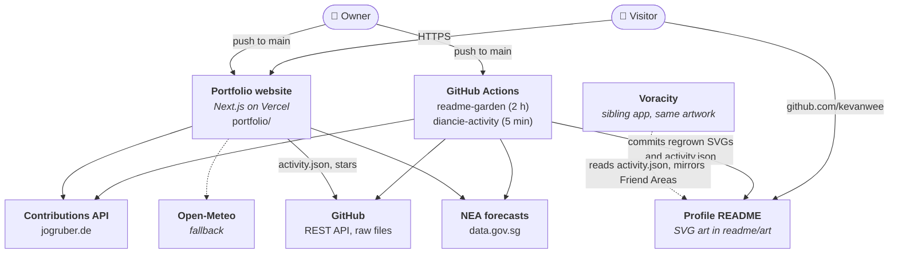
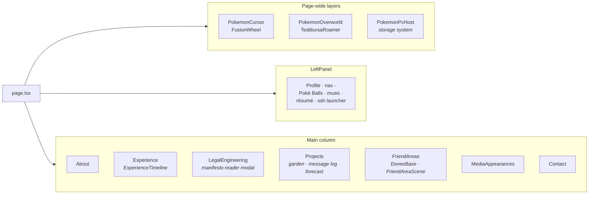
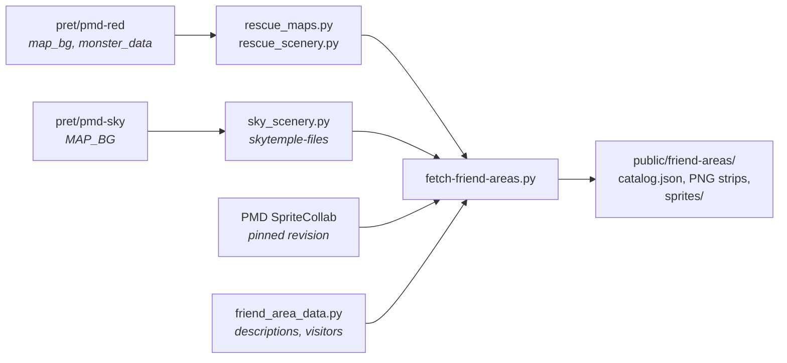
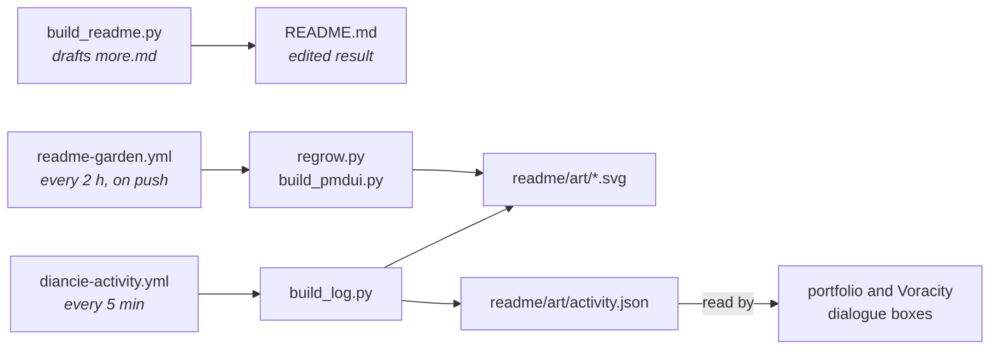
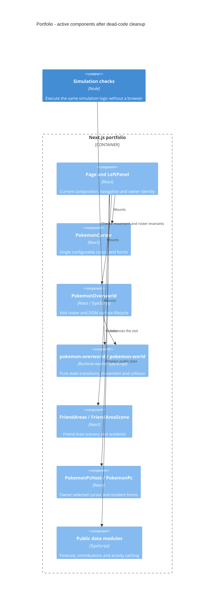
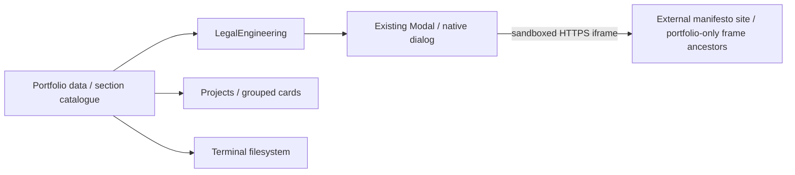

# Architecture

This repository holds three things that share Pokémon artwork and data:

1. **The portfolio website** (`portfolio/`): a Next.js app at <https://kevanwee.vercel.app>.
2. **The GitHub profile README** (`README.md`, `readme/`): self-contained animated SVGs, regrown by
   scheduled GitHub Actions from `genpokemon/readme_art/`.
3. **Map generators** (`genpokemon/`): the Pokémon Emerald roaming SVGs in the README.

The HTML files at the repository root (`index.html`, `about.html`, …) are the earlier static
portfolio. They are kept for reference and are not deployed.

## System context

Nothing runs on a server the owner operates. Vercel builds and serves the site and runs one small
API route. GitHub Actions regrows the README art on a schedule. Live data comes straight from
public APIs in the browser.

## Portfolio website (`portfolio/`)

Next.js 16 (App Router), React 19, TypeScript and Tailwind. Vercel deploys `main` automatically
and skips builds only when a known previous deployment commit confirms no portfolio changes
(`scripts/ignore-vercel-build.cjs`, configured in `vercel.json`). Missing baseline commits in
shallow clones safely trigger a build; pull requests get preview deployments.

### Routes

| Route | Source | Notes |
| --- | --- | --- |
| `/` | `src/app/page.tsx` | The one-page portfolio |
| `/terminal` | `src/app/terminal/page.tsx` | A shell over the site's data (`lib/terminal-shell.ts`) |
| `/api/legalquants-stars` | `src/app/api/legalquants-stars/route.ts` | GitHub star count, uncached |
| 404 | `src/app/not-found.tsx` | "Looks like we're lost": a random crystal cave with Diancie, three Carbink and a lost shiny Psyduck (`LostCave.tsx`) |
| `robots.txt`, `sitemap.xml`, OG image | `src/app/robots.ts`, `sitemap.ts`, `opengraph-image.tsx` | |

### Page composition

`LeftPanel` is always sticky at laptop/desktop widths (1024px and above) and keeps the
classic layout: stacked name, 11px dashed section links, social icons directly under them, and
the green Resume action. It scales continuously to the window height (CSS zoom on
`.left-panel-zoom`, 50–100%), so browser zoom rescales rather than recomposing; only below the
50% floor does the pinned frame scroll inside itself. Phones and tablets stack the columns with
44px targets. Section navigation targets the visible heading (or an explicitly marked content card), skipping decorative top padding.
See `scripts/test-responsive-panel.cjs` for the viewport matrix.

- **Pokémon layers.** The cursor companion, roaming overworld (Route 111 and Mauville maps in
  `public/worlds`) and Teddiursa sit above the page. `lib/motion.ts` and
  `useAnimationVisibility` pause animation when it's offscreen, in a hidden tab or under reduced motion.
- **Pokémon PC** (`components/pc/`). One storage system: the left bar lists boxes (cursor
  companion, Transform Forest, one per Friend Area, free roaming). Choices persist in
  `localStorage` and apply to matching residents. See `portfolio/docs/POKEMON-PC.md`.
- **Friend Areas** (`FriendAreas.tsx`, `FriendAreaScene.tsx`, `friend-areas.ts`). Transform
  Forest (the Eevee garden) plus 72 areas from `public/friend-areas/catalog.json`.
- **Live data.** `lib/activity.ts` reads the README's `activity.json` for the dialogue box;
  `lib/contributions.ts` reads the contribution calendar; `lib/forecast.ts` reads NEA's
  forecast for Castform and the forest sky (`lib/forest-sky.ts`), with Open-Meteo as fallback.
  Each is cached in `localStorage` and refreshed while the tab is visible.

### Media previews

Media & Appearances retains the original compact article strip and static resident perch.
Source cards use a neutral translucent surface; article photographs appear only in the
floating preview. Hover or keyboard focus opens an accessible, dismissible tooltip outside
the strip mask. It stays open while hovered, pauses the strip, and adapts above/below the
link with a compact layout when space is limited. Touch links open directly. Reduced motion
uses a plain scroll row; reduced transparency uses opaque surfaces.
Instagram previews use optimized copies of the public posts' embed images, avoiding
expiring CDN URLs. The inline LegalQuants link shares the preview behavior and shows a
dated page capture with the site's own LQ icon. These assets are snapshots, not live embeds;
their original sources are recorded in `portfolio/public/media/SOURCES.md`.

### Friend Areas pipeline

- Scenery is decoded from the pret decompilations at pinned revisions; no ROM is used. Each
  area has a background, one transparent strip per animated palette or tile slot, and a
  `*-source.json` receipt with SHA-256 hashes.
- Walk zones come from the native collision layer for new areas, or are authored (the
  original eleven, and Explorers maps without collision).
- Residents: Rescue Team natives come from `monster_data.json`; Explorers rosters and 656 later-generation visitors are
  curated by family and habitat. A visit shows at most eight residents.
- Builds never fetch third-party assets. Regeneration is explicit:
  `python scripts/fetch-friend-areas.py --expand`. Details are in `docs/NATIVE-FRIEND-AREAS.md`.

### Tests

Node scripts in `portfolio/scripts/` (no test runner):

| Command | Covers |
| --- | --- |
| `npm run test:world`, `test:overworld`, `test:terminal` | World simulation, overworld behaviour, terminal commands |
| `npm run test:friend-areas` | Every area's assets and three ten-minute visits on walkable floor |
| `npm run test:*:browser` | Playwright checks against a running build (`BASE_URL`); set `PLAYWRIGHT_MODULE` if Playwright isn't installed locally |

## Profile README (`README.md`, `readme/`, `genpokemon/readme_art/`)

GitHub shows README SVGs as images, so every animated piece is a self-contained SVG with
embedded sprites and CSS animation, in light and dark variants chosen by `<picture>`.

- `build_readme.py` drafted the layout (`more.md`); `README.md` is the edited result and is edited directly. The SVGs it points to are regenerated, so change their scripts rather than the files in `readme/art/`.
- Both workflows share one concurrency group so their commits never race. They commit as the
  owner's noreply address, so regrows show on the contribution graph.
- `genpokemon/readme_art/README.md` lists each script; `cast.py` keeps each Pokémon to one appearance.

## Map generators (`genpokemon/`)

`gen_pokemon_roam.py` (Route 111) and `gen_pokemon_roam_mauville.py` render Pokémon Emerald
maps from `data/pokeemerald/` tilesets and emit the roaming SVGs in `readme/`. Walkability
edits live in `debug_tiles/`. See `genpokemon/README.md`.

## Shared with Voracity

Voracity is a separate repository and app. The two share some artwork and code, and keep it in step through matching pull requests:

- The Friend Area catalog, scenery and scripts (`public/friend-areas`, `scripts/*friend*`, `rescue_maps.py`, `sky_scenery.py`).
- The forest sky rules (`forest-sky.ts`), the contribution garden palette and the PC behaviour.
- `readme/art/activity.json`, which both dialogue boxes read.

Changes to any of these should land in both repositories.

## Licensing

Original code and content are all rights reserved (`LICENSE`). Third-party material and its terms are listed in `NOTICE.md`; Pokémon artwork remains its owners'.

## C4: maintained portfolio components (16 October 2026)

Removed the unreachable `ClientWidgets`, `DiancieCursor`, `Hero`, `IcaCanvas`, `IcaFloat`, `Nav`, `PokemonWalker` and `PortfolioModal` components. `PokemonCursor`, `LeftPanel`, the current overworld and the existing dialogs remain the active implementations. Their exclusively used React Three Fiber/Drei/Three dependencies were removed too. Historical root HTML/CSS, artwork and generator sources remain available.

The simulation modules already provide runtime isomorphism: browser components and Node checks execute the same logic. They are functions over explicit state; an inheritance hierarchy would add indirection without useful substitutability here. No new classes are claimed in this diagram. See [the review and remaining work](docs/CODE-QUALITY-REVIEW-2026-10-16.md).

### Legal Engineering and project catalogue (20 October 2026)

The six section links come from `portfolioSections` in `src/data/index.ts`, shared
by the page and left panel. `LegalEngineering` renders its copy from that module
including a call to action inside the Legal Engineer? critique card,
and opens the existing `Modal` with a sandboxed iframe. The manifesto is a separately
deployed external site: the portfolio has no source import or build dependency on
its repository. Its CSP allows framing only by `https://kevanwee.vercel.app`;
localhost and preview deployments use the Open original link. Automated local reader
checks use an explicitly synthetic frame fixture.

Projects retain their curated Highlights, followed by Legal systems & data,
Agent skills & workflows, and Other experiments. The original project array order
and corresponding `other-project-N` resident surface IDs are preserved. Private
skills link to their public guide descriptions. The terminal derives the new
`legal-engineering/legal-engineering.txt` folder from the same data. README categories and
cards are generated from `genpokemon/readme_art/data.py`, with cast assignments in
`cast.py`; light/dark SVG assets are committed under `readme/art`.

Validation: production build; terminal data checks; six-section navigation at desktop
and mobile widths with normal/reduced motion; experience timeline; responsive panel
matrix (24 layouts); reader close/Escape/focus/overflow checks at 1440px and 390px.
The manifesto repository separately checks its actual CSP: production portfolio
origin allowed, unrelated and preview origins blocked.
