

  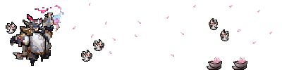

 

  <picture><source media="(prefers-color-scheme: dark)" srcset="./readme/art/header-dark.svg" /></picture>

  
  &nbsp;
  
  &nbsp;
  

  <a href="#cooking"><picture><source media="(prefers-color-scheme: dark)" srcset="./readme/art/nav-cooking-dark.svg" /></picture></a>
  <a href="#cuisines"><picture><source media="(prefers-color-scheme: dark)" srcset="./readme/art/nav-cuisines-dark.svg" />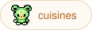</picture></a>
  <a href="#recipes"><picture><source media="(prefers-color-scheme: dark)" srcset="./readme/art/nav-recipes-dark.svg" /></picture></a>
  <a href="#contacts"><picture><source media="(prefers-color-scheme: dark)" srcset="./readme/art/nav-contacts-dark.svg" />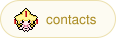</picture></a>

  

  

  <picture><source media="(prefers-color-scheme: dark)" srcset="./readme/art/contribution-garden-dark.svg" /></picture>

  contains information from NEA's 24-hour and 2-hour weather forecasts, accessed from data.gov.sg (updated every two hours) and made available under the <a href="https://data.gov.sg/open-data-licence">Singapore Open Data Licence v1.0</a> · when NEA can't be reached, <a href="https://open-meteo.com/">weather data by Open-Meteo.com</a> (<a href="https://creativecommons.org/licenses/by/4.0/">CC BY 4.0</a>)


  
<picture><source media="(prefers-color-scheme: dark)" srcset="./readme/art/sign-cooking-dark.svg" /></picture> 

   

  

    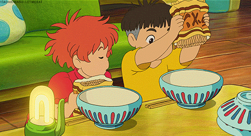
  

   

  

    <picture><source media="(prefers-color-scheme: dark)" srcset="./readme/art/note-cooking-dark.svg" /></picture>
  

  <!-- message log: recent public activity, regrown every two hours -->
  

    <a href="https://github.com/kevanwee?tab=overview"></a>
  

  

    
    &nbsp;
    
    &nbsp;
    
  

   


  
<picture><source media="(prefers-color-scheme: dark)" srcset="./readme/art/sign-cuisines-dark.svg" /></picture> 

   

  

    
  

   

  

    <picture><source media="(prefers-color-scheme: dark)" srcset="./readme/art/note-cuisines-dark.svg" /></picture>
  

  

    <picture><source media="(prefers-color-scheme: dark)" srcset="./readme/art/trees-dark.svg" /></picture>
  

  

    
    
    
    
    
    
    
    
    
    
    
    
    
    
    
  

   


  
<picture><source media="(prefers-color-scheme: dark)" srcset="./readme/art/sign-recipes-dark.svg" /></picture>

 

<!-- section-type:projects:start -->
<h2 align="center"><picture><source media="(prefers-color-scheme: dark)" srcset="./readme/art/heading-projects-dark.svg" /></picture></h2>
<!-- section-type:projects:end -->
<table width="100%"><tr><td>
<!-- section-type:legaltech:start -->
<h3><picture><source media="(prefers-color-scheme: dark)" srcset="./readme/art/heading-legaltech-dark.svg" /></picture></h3>

<picture><source media="(prefers-color-scheme: dark)" srcset="./readme/art/copy-legaltech-1-dark.svg" /></picture>
<picture><source media="(prefers-color-scheme: dark)" srcset="./readme/art/copy-legaltech-2-dark.svg" /></picture>

<!-- section-type:legaltech:end -->

<a href="https://github.com/LegalQuants/lq-plugin-oss"><picture><source media="(prefers-color-scheme: dark)" srcset="./readme/art/card-lq-plugins-dark.svg"></picture></a>
<a href="https://github.com/kevanwee/sg-legalresearch-skill"><picture><source media="(prefers-color-scheme: dark)" srcset="./readme/art/card-sg-legalresearch-skill-dark.svg"></picture></a>
<a href="https://github.com/kevanwee/legal-extraction-skill"><picture><source media="(prefers-color-scheme: dark)" srcset="./readme/art/card-legal-extraction-skill-dark.svg">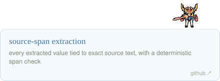</picture></a>
<a href="https://legal-engineering-defined.vercel.app/toolkit"><picture><source media="(prefers-color-scheme: dark)" srcset="./readme/art/card-sg-drafting-skill-dark.svg">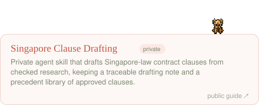</picture></a>
<a href="https://github.com/kevanwee/sg-pdpa-skill"><picture><source media="(prefers-color-scheme: dark)" srcset="./readme/art/card-sg-pdpa-skill-dark.svg"></picture></a>
<a href="https://github.com/kevanwee/sg-deadline"><picture><source media="(prefers-color-scheme: dark)" srcset="./readme/art/card-sg-deadline-dark.svg">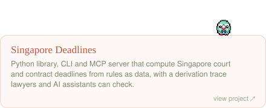</picture></a>
<a href="https://sal-citation-generator.vercel.app"><picture><source media="(prefers-color-scheme: dark)" srcset="./readme/art/card-sal-citation-generator-dark.svg"></picture></a>
<a href="https://copycat-mu.vercel.app"><picture><source media="(prefers-color-scheme: dark)" srcset="./readme/art/card-copycat-dark.svg"></picture></a>
<a href="https://kevanwee.vercel.app/#projects"><picture><source media="(prefers-color-scheme: dark)" srcset="./readme/art/card-bart-dark.svg">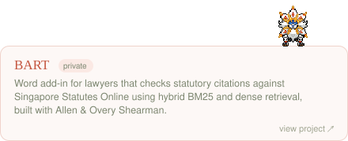</picture></a>
<a href="https://www.legalbenchmarks.ai/"><picture><source media="(prefers-color-scheme: dark)" srcset="./readme/art/card-legalbenchmarks-dark.svg"></picture></a>
<a href="https://github.com/kevanwee/sg-legal-corpus"><picture><source media="(prefers-color-scheme: dark)" srcset="./readme/art/card-sg-legal-corpus-dark.svg"></picture></a>
<a href="https://github.com/kevanwee/citecheck"><picture><source media="(prefers-color-scheme: dark)" srcset="./readme/art/card-citecheck-dark.svg"></picture></a>
<a href="https://github.com/kevanwee/chronology"><picture><source media="(prefers-color-scheme: dark)" srcset="./readme/art/card-chronology-dark.svg"></picture></a>
<a href="https://github.com/kevanwee/oblig-register"><picture><source media="(prefers-color-scheme: dark)" srcset="./readme/art/card-oblig-register-dark.svg">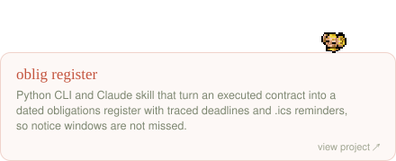</picture></a>
<a href="https://github.com/kevanwee/bundlebuild"><picture><source media="(prefers-color-scheme: dark)" srcset="./readme/art/card-bundlebuild-dark.svg"></picture></a>
<a href="https://github.com/kevanwee/playbook-as-code"><picture><source media="(prefers-color-scheme: dark)" srcset="./readme/art/card-playbook-as-code-dark.svg"></picture></a>
<a href="https://github.com/kevanwee/ipatlas"><picture><source media="(prefers-color-scheme: dark)" srcset="./readme/art/card-ipatlas-dark.svg"></picture></a>
<a href="https://github.com/kevanwee/sightstone"><picture><source media="(prefers-color-scheme: dark)" srcset="./readme/art/card-sightstone-dark.svg">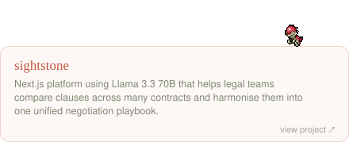</picture></a>
<a href="https://github.com/kevanwee/pdpcscraper"><picture><source media="(prefers-color-scheme: dark)" srcset="./readme/art/card-pdpcscraper-dark.svg"></picture></a>
<a href="https://github.com/kevanwee/elitiscraper"><picture><source media="(prefers-color-scheme: dark)" srcset="./readme/art/card-elitiscraper-dark.svg"></picture></a>
<a href="https://github.com/kevanwee/sgstatutescraper"><picture><source media="(prefers-color-scheme: dark)" srcset="./readme/art/card-sgstatutescraper-dark.svg"></picture></a>
<a href="https://github.com/kevanwee/hansardscraper"><picture><source media="(prefers-color-scheme: dark)" srcset="./readme/art/card-hansardscraper-dark.svg"></picture></a>
<a href="https://github.com/kevanwee/codeoflaw"><picture><source media="(prefers-color-scheme: dark)" srcset="./readme/art/card-codeoflaw-dark.svg"></picture></a>
<a href="https://github.com/kevanwee/crimewatch"><picture><source media="(prefers-color-scheme: dark)" srcset="./readme/art/card-crimewatch-dark.svg"></picture></a>
<a href="https://github.com/kevanwee/justicegap"><picture><source media="(prefers-color-scheme: dark)" srcset="./readme/art/card-justicegap-dark.svg"></picture></a>
<a href="https://github.com/kevanwee/lexlynx"><picture><source media="(prefers-color-scheme: dark)" srcset="./readme/art/card-lexlynx-dark.svg">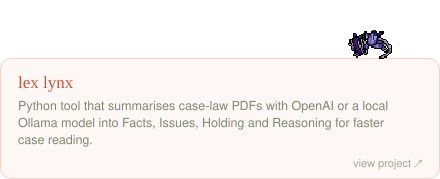</picture></a>
<a href="https://github.com/kevanwee/tortrat"><picture><source media="(prefers-color-scheme: dark)" srcset="./readme/art/card-tortrat-dark.svg"></picture></a>

</td></tr></table>

<table width="100%"><tr><td>
<!-- section-type:process-scrum:start -->
<h3><picture><source media="(prefers-color-scheme: dark)" srcset="./readme/art/heading-process-scrum-dark.svg" /></picture></h3>

<picture><source media="(prefers-color-scheme: dark)" srcset="./readme/art/copy-process-scrum-1-dark.svg" /></picture>
<picture><source media="(prefers-color-scheme: dark)" srcset="./readme/art/copy-process-scrum-2-dark.svg" /></picture>

<!-- section-type:process-scrum:end -->

<a href="https://github.com/kevanwee/bpmn-workflow-skill"><picture><source media="(prefers-color-scheme: dark)" srcset="./readme/art/card-bpmn-workflow-skill-dark.svg"></picture></a>
<a href="https://github.com/kevanwee/scrum-skill"><picture><source media="(prefers-color-scheme: dark)" srcset="./readme/art/card-scrum-skill-dark.svg"></picture></a>
<a href="https://legal-engineering-defined.vercel.app/"><picture><source media="(prefers-color-scheme: dark)" srcset="./readme/art/card-legal-engineering-defined-dark.svg"></picture></a>

</td></tr></table>

<table width="100%"><tr><td>
<!-- section-type:agents-systems:start -->
<h3><picture><source media="(prefers-color-scheme: dark)" srcset="./readme/art/heading-agents-systems-dark.svg" /></picture></h3>

<picture><source media="(prefers-color-scheme: dark)" srcset="./readme/art/copy-agents-systems-1-dark.svg" /></picture>
<picture><source media="(prefers-color-scheme: dark)" srcset="./readme/art/copy-agents-systems-2-dark.svg" /></picture>

<!-- section-type:agents-systems:end -->

<a href="https://github.com/kevanwee/pmd-agents"><picture><source media="(prefers-color-scheme: dark)" srcset="./readme/art/card-pmd-agents-dark.svg"></picture></a>
<picture><source media="(prefers-color-scheme: dark)" srcset="./readme/art/card-voracity-dark.svg"></picture>
<a href="https://github.com/kevanwee/voracity-watcher"><picture><source media="(prefers-color-scheme: dark)" srcset="./readme/art/card-voracity-watcher-dark.svg"></picture></a>

</td></tr></table>

<table width="100%"><tr><td>
<!-- section-type:other-projects:start -->
<h3><picture><source media="(prefers-color-scheme: dark)" srcset="./readme/art/heading-other-projects-dark.svg" /></picture></h3>

<picture><source media="(prefers-color-scheme: dark)" srcset="./readme/art/copy-other-projects-1-dark.svg" /></picture>
<picture><source media="(prefers-color-scheme: dark)" srcset="./readme/art/copy-other-projects-2-dark.svg" /></picture>

<!-- section-type:other-projects:end -->

<a href="https://github.com/kevanwee/apac-lateral-tracker"><picture><source media="(prefers-color-scheme: dark)" srcset="./readme/art/card-apac-lateral-tracker-dark.svg"></picture></a>
<a href="https://legal-engineering-defined.vercel.app/toolkit"><picture><source media="(prefers-color-scheme: dark)" srcset="./readme/art/card-legal-process-modelling-dark.svg"></picture></a>
<a href="https://github.com/kevanwee/hawkshot"><picture><source media="(prefers-color-scheme: dark)" srcset="./readme/art/card-hawkshot-dark.svg"></picture></a>
<a href="https://github.com/kevanwee/mapmole"><picture><source media="(prefers-color-scheme: dark)" srcset="./readme/art/card-mapmole-dark.svg"></picture></a>
<a href="https://github.com/kevanwee/lolpixelart"><picture><source media="(prefers-color-scheme: dark)" srcset="./readme/art/card-lolpixelart-dark.svg"></picture></a>
<a href="https://github.com/kevanwee/kevanwee"><picture><source media="(prefers-color-scheme: dark)" srcset="./readme/art/card-kevanwee-dark.svg"></picture></a>
<a href="https://github.com/kevanwee/kevanweeportfolio"><picture><source media="(prefers-color-scheme: dark)" srcset="./readme/art/card-kevanweeportfolio-dark.svg"></picture></a>
<a href="https://github.com/kevanwee/bookworm"><picture><source media="(prefers-color-scheme: dark)" srcset="./readme/art/card-bookworm-dark.svg"></picture></a>
<a href="https://github.com/kevanwee/HUHH"><picture><source media="(prefers-color-scheme: dark)" srcset="./readme/art/card-huhh-dark.svg"></picture></a>

</td></tr></table>

<!-- section-type:notes:start -->

<picture><source media="(prefers-color-scheme: dark)" srcset="./readme/art/copy-project-notes-1-dark.svg" /></picture>
<picture><source media="(prefers-color-scheme: dark)" srcset="./readme/art/copy-project-notes-2-dark.svg" /></picture>
<picture><source media="(prefers-color-scheme: dark)" srcset="./readme/art/copy-project-notes-3-dark.svg" /></picture>
<picture><source media="(prefers-color-scheme: dark)" srcset="./readme/art/copy-project-notes-4-dark.svg" /></picture>
<picture><source media="(prefers-color-scheme: dark)" srcset="./readme/art/copy-project-notes-5-dark.svg" /></picture>

<!-- section-type:notes:end -->

  <picture><source media="(prefers-color-scheme: dark)" srcset="./readme/art/playground-dark.svg" /></picture>

  

<picture><source media="(prefers-color-scheme: dark)" srcset="./readme/art/sign-contacts-dark.svg" /></picture>

  

  <picture><source media="(prefers-color-scheme: dark)" srcset="./readme/art/note-contacts-dark.svg" /></picture>

  <a href="mailto:kevan.wee.2023@scis.smu.edu.sg"><picture><source media="(prefers-color-scheme: dark)" srcset="./readme/art/contact-email-dark.svg" /></picture></a>
  <a href="https://www.linkedin.com/in/kevanwee/"><picture><source media="(prefers-color-scheme: dark)" srcset="./readme/art/contact-linkedin-dark.svg" /></picture></a>
  <a href="https://www.instagram.com/kwjw30/"><picture><source media="(prefers-color-scheme: dark)" srcset="./readme/art/contact-instagram-dark.svg" /></picture></a>
  <a href="https://www.instagram.com/van.fullofkebabs/"><picture><source media="(prefers-color-scheme: dark)" srcset="./readme/art/contact-art-instagram-dark.svg" /></picture></a>
  <a href="https://www.tiktok.com/@seofon30"><picture><source media="(prefers-color-scheme: dark)" srcset="./readme/art/contact-tiktok-dark.svg" /></picture></a>

  

  sprites by the <a href="https://sprites.pmdcollab.org/">PMD Sprite Collab</a> contributors (each artist credited on its sprite page), <a href="https://creativecommons.org/licenses/by-nc/4.0/">CC BY-NC 4.0</a>, some cropped, recoloured or combined ·
  Friend Area scenery decoded from the <a href="https://github.com/pret/pmd-red">pret/pmd-red</a> and <a href="https://github.com/pret/pmd-sky">pret/pmd-sky</a> decompilations; earlier backgrounds by Toastypk and MYSTERY_DUNGEON via <a href="https://pamtre-berry.neocities.org/articles/friendareas">Pamtre Berry</a> ·
  thunder meadow and rank badges via the <a href="https://mysterydungeon.fandom.com/">Mystery Dungeon Wiki</a> · item icons via <a href="https://github.com/PokeAPI/sprites">PokeAPI</a> ·
  mega evolution symbol by pixelthecollector · drawn and regrown daily by <a href="./genpokemon/readme_art">genpokemon/readme_art</a> · how it fits together: <a href="./ARCHITECTURE.md">ARCHITECTURE.md</a> 
  a non-commercial fan project, not affiliated with or endorsed by Nintendo, Creatures, GAME FREAK or The Pokémon Company · Pokémon © their owners 
  © 2023–2026 Kevan Wee · all rights reserved: see <a href="./LICENSE">LICENSE</a>; third-party material in <a href="./NOTICE.md">NOTICE.md</a>

